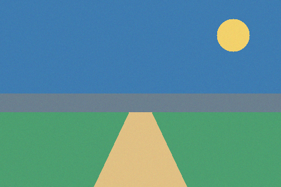
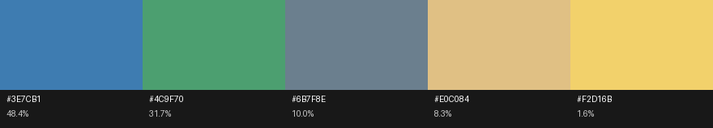

# Image Palette Extractor

Extract the **dominant colours** of an image — as hex codes, RGB
values and pixel shares — by clustering its pixels with a
**from-scratch k-means implementation in numpy** (Lloyd's algorithm
with k-means++ seeding; no scikit-learn). Clustering can run in plain
**RGB** space or in perceptually uniform **CIE L\*a\*b\*** space
(`--space lab`), and the difference is measurable on the bundled
sample image (see *Example output*).

## Background

Dominant-colour extraction is vector quantisation of the pixel cloud:
find *k* centres minimising the **inertia**

```text
J = Σᵢ ‖xᵢ − μ_{c(i)}‖²        (sum of squared distances to the
                                nearest centre)
```

**Lloyd's algorithm** (Lloyd, 1957/1982) alternates assigning points
to their nearest centre and moving centres to the means of their
points; it always converges, but only to a local optimum, so seeding
matters. **k-means++** (Arthur & Vassilvitskii, 2007) seeds centres
from the data with probability proportional to their squared distance
from the centres already chosen, which provably and practically gives
better, faster results. CIELAB exists because RGB distances are not
perceptual distances: equal Euclidean steps in Lab correspond to
roughly equal perceived colour differences (CIE76), so small vivid
regions survive clustering there. The theory, formulas (including the
full sRGB→XYZ→Lab chain) and references are in
[docs/RESEARCH.md](docs/RESEARCH.md).

## What it does

- Clusters an image's pixels with from-scratch k-means
  (`--k`, `--seed`, `--init k-means++|random`, `--max-iter`),
  reporting iterations and **final inertia** on every run.
- Two clustering spaces: `--space rgb` (default) and `--space lab`
  (pixels converted sRGB → CIE Lab, D65; centres converted back for
  display).
- Outputs a text palette (`#RRGGBB, rgb(...), share %`) and a swatch
  strip PNG with per-colour labels.
- Ships a synthetic **sample image with known ground truth** (five
  flat regions: sky, hills, grass, path, sun) generated by the tool
  itself, so extraction quality can be checked, not just admired.
- Deterministic: same seed ⇒ same result. Large images are evenly
  sub-sampled to a pixel budget (`--max-pixels`).

## Requirements

```bash
pip install -r requirements.txt   # numpy, Pillow
```

(Developed and verified with numpy 1.26 / Pillow 10.2.)

## How to run

```bash
# generate the bundled sample image (prints its ground truth)
python3 palette.py sample --out examples/sample.png

# extract in RGB space (writes palette.txt + palette.png)
python3 palette.py extract examples/sample.png --k 5 \
    --out examples/palette.png --txt examples/palette.txt

# extract in CIE Lab space
python3 palette.py extract examples/sample.png --k 5 --space lab \
    --out examples/palette_lab.png --txt examples/palette_lab.txt

# run the tests
python3 tests/test_kmeans.py
python3 tests/test_colorconv.py
```

## Example output

Real runs on the bundled sample (480×320, ground truth: sky
`#3E7CB1` 48.4 %, grass `#4C9F70` 31.7 %, hills `#6B7F8E` 10.0 %,
path `#E0C084` 8.3 %, sun `#F2D16B` 1.6 %; full logs in
`examples/palette.txt` and `examples/palette_lab.txt`):

**Lab space — perfect recovery** (5 iterations, inertia 1,381,752.9):

```text
#3E7CB1  rgb( 62, 124, 177)   48.4%
#4C9F70  rgb( 76, 159, 112)   31.7%
#6B7F8E  rgb(107, 127, 142)   10.0%
#E0C084  rgb(224, 192, 132)    8.3%
#F2D16B  rgb(242, 209, 107)    1.6%
```

**RGB space — a worse local optimum** (26 iterations, inertia
6,305,558.4): the sky is split into two near-identical blues
(`#407CB1` 24.3 % + `#3C7CB1` 24.1 %), and the sun is absorbed into
the path cluster (`#E3C380` 9.8 % ≈ 8.3 + 1.6 %). Grass and hills are
still recovered exactly. This is Lloyd's algorithm behaving exactly
as the theory says it can — and the reason the Lab mode exists:
in Lab, the sun is perceptually far from the path, so it earns its
own centre, while the sky's noise cloud stays one cluster. (The two
inertia values are in different units — RGB² vs ΔE² — and are not
comparable across spaces.)





## Project structure

```text
image-palette-extractor/
├── palette.py                  # entry-point shim (puts src/ on the path)
├── requirements.txt            # numpy, Pillow
├── src/palette/
│   ├── __init__.py             # public API re-exports
│   ├── kmeans.py               # Lloyd's algorithm + k-means++ (from scratch)
│   ├── colorconv.py            # sRGB <-> XYZ <-> CIE Lab conversions
│   ├── imaging.py              # image loading, sample generator, swatches
│   └── cli.py                  # argparse CLI: extract / sample
├── tests/
│   ├── test_kmeans.py          # blob recovery, inertia, reproducibility
│   └── test_colorconv.py       # published Lab reference values, round trip
├── examples/
│   ├── sample.png              # synthetic ground-truth image
│   ├── palette.png / .txt      # RGB-space run outputs
│   └── palette_lab.png / .txt  # Lab-space run outputs
├── docs/RESEARCH.md            # algorithm + colour-science background
├── LICENSE                     # MIT
└── README.md
```

## Design decisions

- **From-scratch k-means, deliberately.** The point of the project is
  the algorithm, so Lloyd's iteration and k-means++ seeding are
  implemented directly in numpy (vectorised squared distances via
  ‖x−c‖² = ‖x‖² − 2x·c + ‖c‖²). scikit-learn's API semantics
  (`inertia_`, `tol`, `max_iter`) are mirrored, but its `n_init`
  best-of-many-runs stage is **not**: one run per explicit `--seed`
  keeps every result reproducible from the command line (documented
  in the research notes).
- **Lab mode converts pixels, not just centres.** Clustering happens
  entirely in Lab; only the final centroids are converted back to
  sRGB for reporting, so assignments reflect perceptual distance.
- **Ground truth over glamour.** The sample image is synthetic and
  flat *on purpose*: its exact region shares are known, so the
  extractor's accuracy is a measurement, not an impression. On real
  photographs there is no ground truth, but the same seed/inertia
  reporting applies.
- **Empty clusters are restarted** at the worst-served point instead
  of being dropped, so the tool always returns exactly *k* colours.

## How it works

`imaging.load_pixels` reads the image with Pillow and optionally
sub-samples it. `colorconv` converts to Lab if requested.
`kmeans.kmeans` seeds centres with k-means++ (first centre uniform,
later centres D²-weighted) and iterates Lloyd's assignment/update
steps to convergence, tracking inertia. `cli` sorts centres by pixel
share, formats the palette, and `imaging.draw_swatch` renders the
labelled swatch strip.

## Limitations & future work

- Lloyd's algorithm finds **local** optima: different seeds can give
  different palettes (try `--seed 1`). Reporting inertia on every run
  makes runs comparable; a best-of-N `--n-init` flag is the obvious
  next step.
- CIE76 distance is used in Lab; CIEDE2000 is more accurate
  perceptually but is not a coordinate metric, so it cannot drive
  centroid updates.
- Lab centroids can fall slightly outside the sRGB gamut; they are
  clipped on conversion back (rare, and only affects the displayed
  hex, not the clustering).
- Alpha channels are flattened by Pillow's RGB conversion; no
  transparency-aware weighting.
- Choosing *k* is manual — an elbow/silhouette sweep over k would be
  a useful addition for photographs.

## References

Full list with links in [docs/RESEARCH.md](docs/RESEARCH.md). Key
sources: Lloyd (1982), "Least squares quantization in PCM", *IEEE
Trans. Information Theory*; Arthur & Vassilvitskii (2007),
"k-means++: The Advantages of Careful Seeding", *SODA*; scikit-learn
`KMeans` documentation (inertia/API semantics); Bruce Lindbloom's
sRGB/XYZ/Lab conversion constants and matrices.
